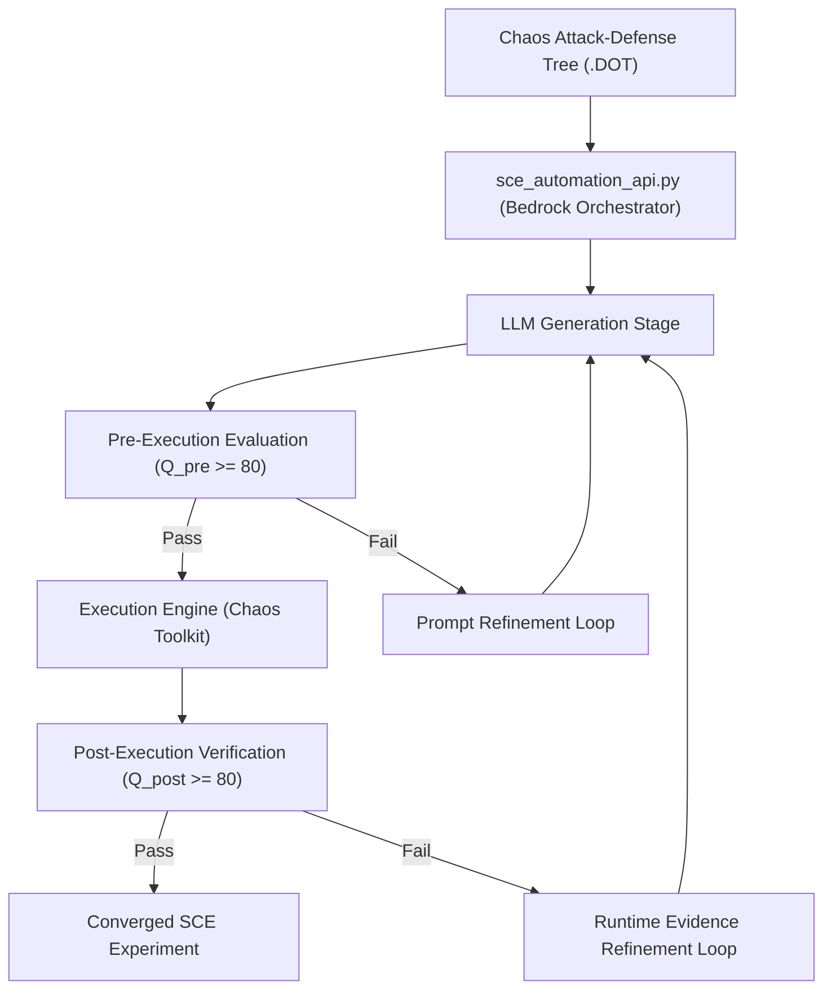

# Consolidated Experimental Campaign: LLM-Driven Chaos Attack–Defense Trees (IJIS)

[](#)
[](#)
[](LICENSE)

> [!NOTE]
> **Branch Context:** This branch (`ijis-experiments`) combines the complete experimental campaigns developed for the manuscript:
> 
> **“LLM-Driven Chaos Attack–Defense Trees for Empirical Security Validation in DevSecOps Scenarios”**  
> *Submitted to the International Journal of Information Security (IJIS).*
> 
> It preserves the complete experimental campaign, retaining all generated experiment scripts, execution journals, metric evaluation reports, and iterative refinement tracking logs across all evaluated foundation models.
> 
> *For the frozen, sanitized evaluation package prepared for peer-review validation, please see the [`reproducibility/ijis-paper`](https://github.com/mariomc14/devsecops-adversary-llm/tree/reproducibility/ijis-paper) branch.*

---

## 🔬 Experimental Architecture

The framework automates the generation and iterative refinement of Security Chaos Engineering (SCE) experiments from Chaos Attack-Defense Trees (Chaos ADTs).



### Evaluated Foundation Models (AWS Bedrock)

The experimental campaign evaluated state-of-the-art LLMs via the AWS Bedrock Converse API with standardized inference settings (`maxTokens: 8192`, `temperature: 1`):
* Claude 3.5 Haiku (`us.anthropic.claude-3-5-haiku-20241022-v1:0`)
* Claude Haiku 4.5 (`us.anthropic.claude-haiku-4-5-20251001-v1:0`)
* Claude Sonnet 4.6 (`us.anthropic.claude-sonnet-4-6`)
* Claude Opus 4.5 (`us.anthropic.claude-opus-4-5-20251101-v1:0`)
* Claude Opus 4.6 (`us.anthropic.claude-opus-4-6-v1`)

---

## 📁 Repository & Experiment Directory Structure

```text
automate/
├── sce_automation_api.py           # Core reference generation & refinement orchestrator
├── attack_defense_tree.dot         # Input Chaos Attack-Defense Tree in Graphviz format
├── attacks.yaml                    # Threat scenario specification and node definitions
├── requirements.txt                # Pinned dependencies for automation and evaluation
│
├── chaos_1_experiments/           # Branch 1 Experiments (EC2 IMDS privilege escalation)
│   ├── experiments_1_detective/   # Detective defense validation scripts (.py & .json)
│   ├── experiments_1_preventive/  # Preventive defense validation scripts (.py & .json)
│   └── experiments_1_reactive/    # Reactive defense validation scripts (.py & .json)
│
├── chaos_2_experiments/           # Branch 2 Experiments (CodeBuild project compromise)
│   ├── experiments_2_detective/   # Detective defense validation scripts
│   ├── experiments_2_preventive/  # Preventive defense validation scripts
│   └── experiments_2_reactive/    # Reactive defense validation scripts
│
├── chaos_1_reports/               # Pre/post-execution metric reports for Branch 1
├── chaos_2_reports/               # Pre/post-execution metric reports for Branch 2
│
├── Experimentos-Haiku-3.5/        # Model-organized experiments & reports (Haiku 3.5)
├── Experimentos-Haiku-4.5/        # Model-organized experiments & reports (Haiku 4.5)
├── Experimentos-Sonnet-4.6/       # Model-organized experiments & reports (Sonnet 4.6)
├── Experimentos-Opus-4.5/         # Model-organized experiments & reports (Opus 4.5)
├── Experimentos-Opus-4.6/         # Model-organized experiments & reports (Opus 4.6)
│
├── 1_tracking_summary_*.md        # Branch 1 refinement tracking tables
├── 2_tracking_summary_*.md        # Branch 2 refinement tracking tables
├── tracking_summary.md            # Execution tracking session logs
└── additional_tracking_summary.md # Additional preserved model tracking sessions
```

---

## ⚙️ Running the Automation Workflow

### 1. Requirements & Credentials

Configure AWS Bedrock credentials with permissions for model invocation:

```bash
cd automate
pip install -r requirements.txt
```

### 2. Execution

To trigger the automated generation and refinement loop:

```bash
python3 sce_automation_api.py
```

The script:
1. Loads the structural threat model from `attack_defense_tree.dot` and scenario specifications from `attacks.yaml`.
2. Prompts Bedrock models to synthesize Chaos Toolkit actions, probes, and JSON definitions.
3. Automatically evaluates structural factors ($Q_{pre}$) against the rubric.
4. Executes compliant experiments within an isolated AWS sandbox using Chaos Toolkit.
5. Verifies runtime evidence ($Q_{post}$) and iteratively refines until convergence or budget exhaustion.

---

## 📚 Related Branches & Releases

* [`main`](https://github.com/mariomc14/devsecops-adversary-llm/tree/main): Master index and navigation hub.
* [`reproducibility/ijis-paper`](https://github.com/mariomc14/devsecops-adversary-llm/tree/reproducibility/ijis-paper) (`tag: v2.0-ijis-reproducibility`): Sanitized, release-ready reproducibility archive.
* [`jnic`](https://github.com/mariomc14/devsecops-adversary-llm/tree/jnic) (`tag: v1.0-jnic`): Conference artifacts for JNIC 2026.
