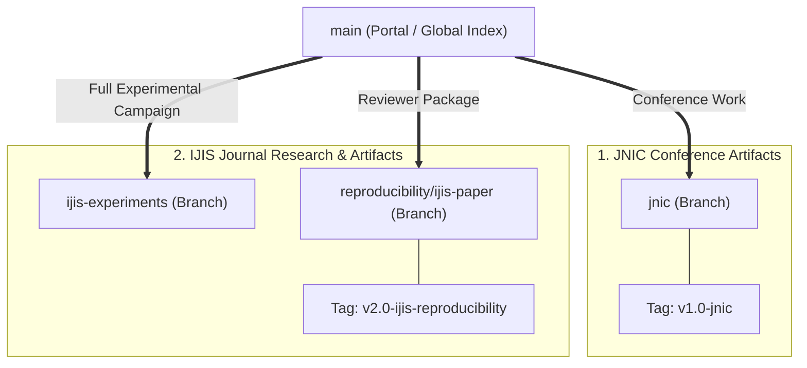

# DevSecOps Adversary LLM: Empirical Security Validation & Chaos Attack–Defense Trees

[](https://www.springer.com/journal/10207)
[](https://jnic.es)
[](https://arxiv.org/abs/2602.14106)
[](#)
[](#)
[](LICENSE)

Welcome to the central repository for the research on **LLM-driven threat modeling and Security Chaos Engineering (SCE) in cloud-native DevSecOps scenarios**.

This repository hosts and indexes the artifacts, experimental datasets, automation pipelines, and reproducibility materials supporting two successive peer-reviewed works:
1. **Conference Work (JNIC 2026):** *“Anticipating Adversary Behavior in DevSecOps Scenarios through Large Language Models”* (arXiv: [2602.14106](https://arxiv.org/abs/2602.14106)).
2. **Extended Journal Work (IJIS):** *“LLM-Driven Chaos Attack–Defense Trees for Empirical Security Validation in DevSecOps Scenarios”* (Submitted to the *International Journal of Information Security*).

---

## 🗺️ Repository Architecture & Branch Navigation

To maintain complete historical fidelity, strict reproducibility for reviewers, and clean separation of concerns, the repository is structured into dedicated branches:



| Branch | Release Tag | Focus | Key Contents |
|---|---|---|---|
| **[`main`](https://github.com/mariomc14/devsecops-adversary-llm/tree/main)** | — | **Repository Portal** | Central index, global roadmap, comparative synthesis, and bibliographic metadata. |
| **[`jnic`](https://github.com/mariomc14/devsecops-adversary-llm/tree/jnic)** | [`v1.0-jnic`](https://github.com/mariomc14/devsecops-adversary-llm/releases/tag/v1.0-jnic) | **JNIC 2026 Paper** | Attack tree generation prompts, QwQ-32B vs GPT-4 trees, and single-scenario SCE experiment (Spot EC2 privilege escalation). |
| **[`ijis-experiments`](https://github.com/mariomc14/devsecops-adversary-llm/tree/ijis-experiments)** | — | **IJIS Consolidated Experiments** | Complete experimental campaign codebase, reference Bedrock orchestrator, iterative refinement loops, and all model-organized experimental outputs. |
| **[`reproducibility/ijis-paper`](https://github.com/mariomc14/devsecops-adversary-llm/tree/reproducibility/ijis-paper)** | [`v2.0-ijis-reproducibility`](https://github.com/mariomc14/devsecops-adversary-llm/releases/tag/v2.0-ijis-reproducibility) | **IJIS Reproducibility Package** | Frozen, peer-review package: sanitized experiment artifacts, SHA256 checksums, normalized input DAGs, execution logs, and validation scripts. |

---

## 📊 Comparison of Research Phases

| Dimension | JNIC 2026 Conference Work | IJIS Extended Journal Work |
|---|---|---|
| **Manuscript Title** | *Anticipating Adversary Behavior in DevSecOps Scenarios through Large Language Models* | *LLM-Driven Chaos Attack–Defense Trees for Empirical Security Validation in DevSecOps Scenarios* |
| **Primary Scope** | Feasibility study of LLMs constructing ADTs & manual translation into a single SCE experiment. | End-to-end framework automating Chaos ADT generation, multi-stage SCE translation, and iterative convergence. |
| **Target Scenarios** | Military logistics supply chain scenario (AWS EC2 Spot Instance privilege escalation). | Cloud-native DevSecOps banking scenario with 2 distinct attack branches: (1) EC2 IMDS privilege escalation and (2) AWS CodeBuild project compromise. |
| **Evaluated Models** | QwQ-32B and GPT-4. | 5 Anthropic Claude models via AWS Bedrock: Haiku 3.5, Haiku 4.5, Sonnet 4.6, Opus 4.5, Opus 4.6. |
| **Execution Loop** | Manual prompt sequence and local Chaos Toolkit execution. | Automated closed-loop orchestrator (`sce_automation_api.py`) with programmatic AWS Bedrock Converse API invocation and refinement budgeting. |
| **Evaluation Metrics** | 3 qualitative dimensions (Fidelity, Hierarchy, Executability). | Quantitative dual-stage metric rubric: Pre-execution structural compliance ($Q_{pre}$) and Post-execution runtime observability ($Q_{post}$). |
| **Reproducibility** | Preserved prompt templates and experiment runner. | Full cryptographic reproducibility package (`SHA256SUMS.txt`), normalized DAGs, tracking tables, and attempt histories. |

---

## 🚀 Quick Navigation & Access

### 1. Replicating the IJIS Reproducibility Package

To validate the frozen artifacts cited in the IJIS journal paper:

```bash
# Clone the repository
git clone https://github.com/mariomc14/devsecops-adversary-llm.git
cd devsecops-adversary-llm

# Checkout the immutable reproducibility tag
git checkout v2.0-ijis-reproducibility

# Verify package integrity
cd reproducibility
sha256sum -c SHA256SUMS.txt
```

### 2. Exploring the Complete Experimental History (IJIS)

To inspect the development scripts, raw outputs across foundation models, and complete Git commit history:

```bash
git checkout ijis-experiments
cd automate
```

### 3. Replicating the JNIC Conference Work

To review the initial study and run the original Spot EC2 privilege escalation experiment:

```bash
git checkout v1.0-jnic
cd SCE_Experiment/Runner
./run.sh SCE_Experiment.json
```

---

## 📚 Bibliographic Citations

If you use or build upon this work, please cite the corresponding publication:

### Journal Paper (IJIS)
```bibtex
@article{nespoli2026llmdriven,
  title   = {LLM-Driven Chaos Attack--Defense Trees for Empirical Security Validation in DevSecOps Scenarios},
  author  = {Nespoli, Pantaleone and Mar{\'\i}n-Caballero, Mario and Betancourt Alonso, Miguel and D{\'\i}az-L{\'o}pez, Daniel and Perales G{\'o}mez, Angel Luis},
  journal = {International Journal of Information Security},
  year    = {2026},
  note    = {Under review}
}
```

### Conference Paper (JNIC 2026)
```bibtex
@inproceedings{marin2026anticipating,
  title     = {Anticipating Adversary Behavior in DevSecOps Scenarios through Large Language Models},
  author    = {Mar{\'\i}n-Caballero, Mario and Betancourt Alonso, Miguel and D{\'\i}az-L{\'o}pez, Daniel and Perales G{\'o}mez, Angel Luis and Nespoli, Pantaleone and Mart{\'\i}nez P{\'e}rez, Gregorio},
  booktitle = {Actas de las X Jornadas Nacionales de Investigaci{\'o}n en Ciberseguridad (JNIC 2026)},
  year      = {2026},
  eprint    = {2602.14106},
  archivePrefix = {arXiv},
  primaryClass  = {cs.CR},
  url       = {https://arxiv.org/abs/2602.14106}
}
```

---

## 👥 Authors & Collaborating Institutions

* **University of Murcia (Spain)** — Department of Information and Communications Engineering / Department of Computer Engineering and Technology:
  * Mario Marín-Caballero (`mario.m.c@um.es`)
  * Pantaleone Nespoli (`pantaleone.nespoli@um.es`)
  * Angel Luis Perales Gómez (`angelluis.perales@um.es`)
  * Gregorio Martínez Pérez (`gregorio@um.es`)
* **Universidad del Rosario (Colombia)** — School of Engineering, Science and Technology:
  * Miguel Betancourt Alonso (`miguels.betancourt@urosario.edu.co`)
  * Daniel Díaz-López (`danielorlando.diaz@um.es`, Corresponding Author)
