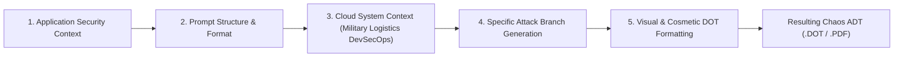
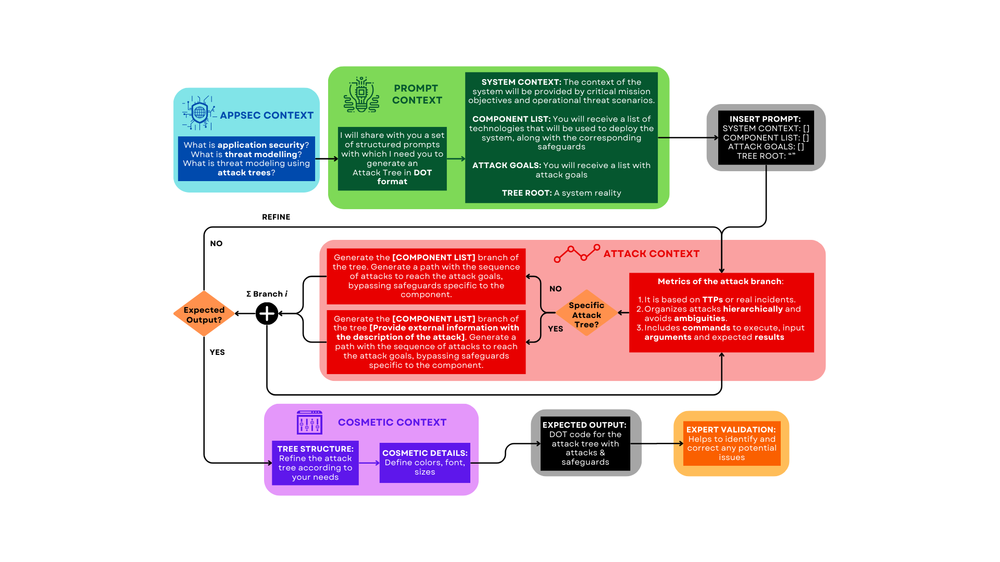
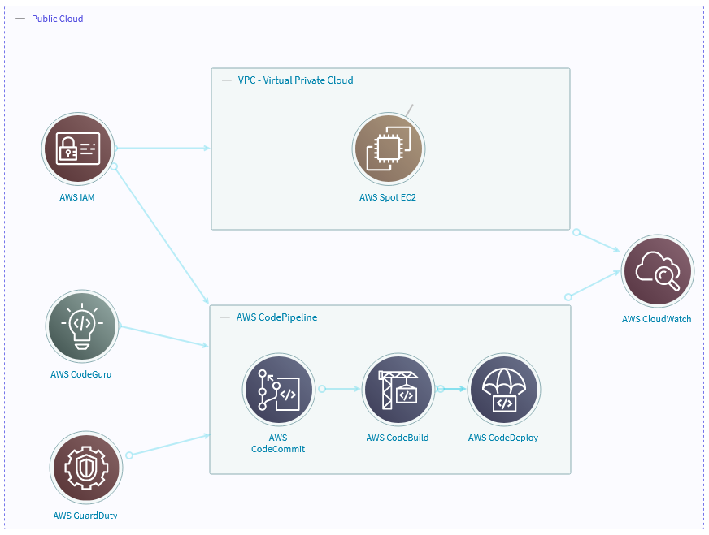

# Anticipating Adversary Behavior in DevSecOps Scenarios through Large Language Models (JNIC 2026)

[](https://jnic.es)
[](https://arxiv.org/abs/2602.14106)
[](LICENSE)
[](#)

> [!NOTE]
> **Branch Context:** This branch (`jnic`) hosts the code, prompt structures, and Security Chaos Engineering (SCE) validation experiments associated with the paper published at **JNIC 2026**:
> 
> *“Anticipating Adversary Behavior in DevSecOps Scenarios through Large Language Models”* (arXiv: [2602.14106](https://arxiv.org/abs/2602.14106)).
> 
> *For the extended framework submitted to the **International Journal of Information Security (IJIS)** (currently under review), please refer to the [`ijis-experiments`](https://github.com/mariomc14/devsecops-adversary-llm/tree/ijis-experiments) branch and the dedicated [`reproducibility/ijis-paper`](https://github.com/mariomc14/devsecops-adversary-llm/tree/reproducibility/ijis-paper) branch.*

---

## 📖 Project Overview

Modern cloud-native organizations face increasingly sophisticated cyber threats targeting DevSecOps pipelines. While agility is paramount, neglecting proactive security accumulates vulnerabilities. This research demonstrates how Large Language Models (LLMs) can be integrated with **Security Chaos Engineering (SCE)** to:
1. Automatically construct structured **Attack-Defense Trees (ADTs)** that model plausible adversary paths in cloud DevSecOps scenarios.
2. Translate selected attack branches into executable Chaos Toolkit experiments to validate cloud defenses under controlled, real-world conditions.

---

## 📁 Repository Structure

```text
├── Attack_Tree_Generation/
│   ├── Prompts.txt             # Structured prompt sequence for ADT generation
│   ├── Flow_Diagram.png        # Workflow diagram for attack tree generation
│   ├── AttackProcedures.pdf    # Technical attack procedures provided to the LLMs
│   ├── qwq.pdf / qwq.dot       # Attack tree generated by QwQ-32B (visual PDF + Graphviz DOT)
│   └── gpt4.pdf / gpt4.dot     # Attack tree generated by GPT-4 (visual PDF + Graphviz DOT)
│
├── SCE_Experiment/
│   ├── aws-topology-diagram.png# Cloud architecture and DevSecOps pipeline topology
│   ├── KnowledgeDB/            # Knowledge base and rule configurations
│   ├── Runner/                 # Chaos Toolkit execution engine
│   │   ├── actions/            # Injection scripts (actions.py)
│   │   ├── probes/             # Observability & verification scripts (probes.py)
│   │   ├── run.sh              # Orchestration & automated setup runner
│   │   └── SCE_Experiment.json # Chaos experiment definition
│   └── requirements.txt        # Pinned dependencies for the SCE runner
│
├── automate/                   # Early automation prototype of the SCE generation workflow
├── LICENSE                     # Apache 2.0 license
└── README.md                   # Documentation for this JNIC artifact branch
```

---

## 🤖 LLM Generation & Evaluation

### Evaluated Model Configurations

| Feature / Parameter | QwQ-32B (Official) | GPT-4 (Official) |
|---|---|---|
| **Model Size** | 32 billion parameters | Large proprietary (undisclosed) |
| **Context Window** | Up to 131,072 tokens (YaRN) | 8,192 tokens |
| **Max Tokens (Gen)** | Up to 32,768 tokens | Up to 8,192 tokens |
| **Temperature** | ~0.6 | Default managed |
| **Top-P / Nucleus** | 0.95 | Default managed |
| **Top-K** | 20–40 | Default managed |
| **Presence Penalty**| 0.0–2.0 | Default managed |
| **Checkpoint** | `QwQ-32B` | `gpt-4-0613` |
| **Special Features**| Chain-of-thought & self-reflection | Native function calling & API streaming |

---

### Comparative Evaluation (Table I in Paper)

The attack-defense trees generated by both models were systematically scored across three core dimensions: **TTP Fidelity & Realism**, **Hierarchical Structure**, and **Execution Completeness**:

| Metric / Dimension | QwQ-32B | GPT-4 |
|---|---|---|
| **TTP Fidelity & Realism** | High adherence to MITRE ATT&CK techniques | High adherence to MITRE ATT&CK techniques |
| **Structural Depth & Hierarchy** | Rich branching with explicit defense convergence | Concise branching, clear progression |
| **Command & Parameter Precision** | Includes executable AWS CLI syntax & parameters | High syntactic precision with realistic parameters |

---

## 🛠️ Methodology & Prompt Design

The generation workflow guides the LLM through a phased sequence of contextual prompts (`Attack_Tree_Generation/Prompts.txt`):





1. **Application security context:** Establishing threat modeling primitives and Attack-Defense Tree concepts.
2. **Prompt context:** Instructing the model on graph representations using Graphviz `.DOT` format.
3. **System context:** Supplying the DevSecOps case study (military logistics tracking supplies across cloud infrastructure with Amazon GuardDuty, AWS CodeBuild, and CodeGuru).
4. **Attack context:** Enforcing attack constraints (e.g., EC2 Spot Instance privilege escalation via `ec2:RequestSpotInstances` and `iam:PassRole`).
5. **Cosmetic context:** Standardizing color schemas (attacks: `#ACCFF2`, defenses: `#0683FF`) and layout clarity.

---

## ☁️ Experimental Validation: Security Chaos Engineering (SCE)

### Scenario Architecture

The experimental validation targets an AWS DevSecOps environment where a misconfigured IAM policy allows an adversary to perform privilege escalation:



* **Hypothesis:** AWS GuardDuty will detect anomalous privilege escalation when an EC2 Spot Instance is launched with malicious user data.
* **Steady State:** A secure AWS environment where GuardDuty actively alerts on unauthorized privilege escalation, and security controls remain non-exploitable.
* **Adversary Action:** Steal credentials using an EC2 Spot instance with attached `EC2-CloudWatch-Agent-Role`.

---

### Step-by-Step Replication

#### 1. Environment & Prerequisites

* Python ≥ 3.12
* AWS CLI ≥ v2.22 configured with appropriate credentials:

```bash
aws configure set aws_access_key_id <YOUR_KEY_ID>
aws configure set aws_secret_access_key <YOUR_SECRET_KEY>
aws configure set region us-east-1
```

#### 2. IAM Configuration

1. In the AWS IAM Console, create an IAM Policy named `EC2-CloudWatch-Agent-Policy`:
```json
{
    "Version": "2012-10-17",
    "Statement": [
        {
            "Effect": "Allow",
            "Action": [
                "ec2:RequestSpotInstances",
                "iam:PassRole",
                "iam:ListUsers"
            ],
            "Resource": "*"
        }
    ]
}
```
2. Create an IAM Role named `EC2-CloudWatch-Agent-Role` trusted by `ec2.amazonaws.com` and attach `EC2-CloudWatch-Agent-Policy`.

#### 3. Execution via Chaos Toolkit

Configure your ngrok authtoken in `SCE_Experiment/Runner/actions/actions.py` (if utilizing interactive reverse shells), then execute:

```bash
cd SCE_Experiment/Runner
chmod +x run.sh
./run.sh SCE_Experiment.json
```

The runner automatically sets up the Python virtual environment, installs dependencies from `requirements.txt`, deploys module overrides, executes the experiment, and logs runtime journals to `journal.json` and `chaostoolkit.log`.

---

## 📚 Citation

If you use or reference this work in your research, please cite the JNIC conference paper:

```bibtex
@inproceedings{marin2026anticipating,
  title     = {Anticipating Adversary Behavior in DevSecOps Scenarios through Large Language Models},
  author    = {Mar{\'\i}n-Caballero, Mario and Betancourt Alonso, Miguel and D{\'\i}az-L{\'o}pez, Daniel and Perales G{\'o}mez, Angel Luis and Nespoli, Pantaleone and Mart{\'\i}nez P{\'e}rez, Gregorio},
  booktitle = {Actas de las X Jornadas Nacionales de Investigaci{\'o}n en Ciberseguridad (JNIC 2026)},
  year      = {2026},
  eprint    = {2602.14106},
  archivePrefix = {arXiv},
  primaryClass  = {cs.CR},
  url       = {https://arxiv.org/abs/2602.14106}
}
```

---

## 📬 Contact

* **Mario Marín-Caballero:** [mario.m.c@um.es](mailto:mario.m.c@um.es) — University of Murcia
* **Daniel Díaz-López:** [danielorlando.diaz@um.es](mailto:danielorlando.diaz@um.es) — University of Murcia / Universidad del Rosario
